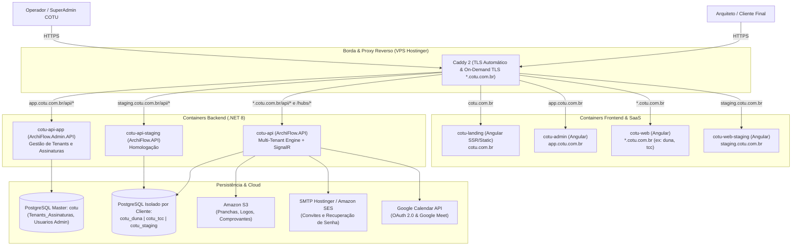
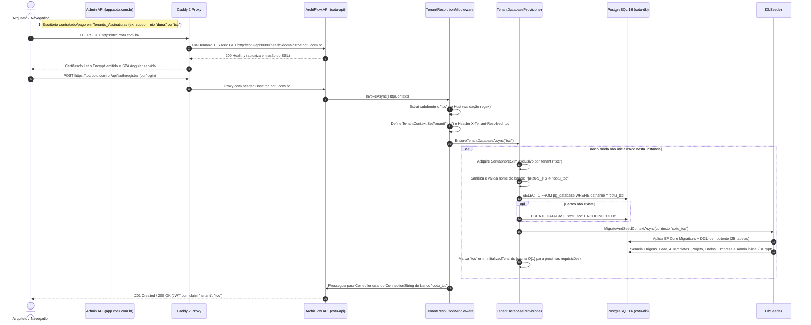

# Arquitetura Multi-Tenant, Pagamento/Assinatura e Criação Automática da Base de Dados

Este documento explica em detalhes **como a plataforma COTU (ArchiFlow) opera como um SaaS Multi-Tenant**, como ocorre o fluxo desde a contratação/pagamento até a criação automática do banco de dados isolado de um novo escritório, e quais mecanismos garantem que um cliente nunca acesse dados de outro.

---

## 1. Visão Geral do Ecossistema (5 Aplicações)

Ao contrário do esboço monolítico inicial do RFC, a arquitetura em produção foi dividida em **5 serviços especializados** executando em containers Docker atrás de um proxy reverso **Caddy 2**, compartilhando um servidor **PostgreSQL 16** com múltiplos bancos isolados:

---

## 2. Como Funciona a Criação da Base (Contratação/Pagamento → Provisionamento)

### 2.1 Camada Comercial e Gestão de Assinaturas (`ArchiFlow.Landing` + `ArchiFlow.Admin.API`)

1. **Escolha do Plano na Landing Page (`cotu.com.br`):**
   - A `ArchiFlow.Landing` apresenta três planos dimensionados para escritórios de arquitetura (com ciclos mensal e anual com 20% de desconto e 14 dias de trial):
     - **Starter** (R$ 129/mês ou R$ 99/mês anual): até 5 projetos ativos, 3 membros, 15 GB AWS S3.
     - **Professional** (R$ 199/mês ou R$ 159/mês anual): projetos ilimitados, 5 membros, Portal White-Label, Financeiro, Fornecedores, 50 GB AWS S3.
     - **Enterprise** (R$ 399/mês ou R$ 319/mês anual): usuários e projetos ilimitados, 250 GB AWS S3, suporte prioritário.
   - O cliente preenche seu e-mail profissional no formulário de solicitação de conta/trial.

2. **Registro da Assinatura e Confirmação de Pagamento (`app.cotu.com.br`):**
   - Na central **COTU SuperAdmin** (`ArchiFlow.Admin` + `ArchiFlow.Admin.API`), cada escritório contratante é registrado na tabela **`Tenants_Assinaturas`** do banco master `cotu`.
   - Ao cadastrar um escritório (`POST /api/superadmin/escritorios`), define-se: `NomeEscritorio`, `Subdominio` (ex.: `duna`, `tcc`, `estudioluz`), `EmailResponsavel`, `Plano`, `ValorMensalidade` e `StatusFinanceiro` inicial (`Trial` com 14 dias).
   - Quando o pagamento é realizado/confirmado (`POST /api/superadmin/escritorios/{id}/registrar-pagamento`), a `Admin.API`:
     - Atualiza `TAS_Status_Financeiro = "Adimplente"`,
     - Registra `TAS_Ultimo_Pagamento = UtcNow`,
     - Prorroga `TAS_Data_Vencimento` (+1 mês),
     - Garante `TAS_Bloqueado_Inadimplencia = false`.
   - Em caso de inadimplência, o painel calcula dias de atraso, gera cobrança via WhatsApp e permite bloquear o tenant (`PUT /api/superadmin/escritorios/{id}/bloquear`).

> **Transparência sobre o escopo atual do pagamento:** A gestão completa de planos, status financeiro (`Trial`, `Adimplente`, `EmDebito`), registro de pagamento e bloqueio já funciona na `ArchiFlow.Admin.API` (`app.cotu.com.br`), enquanto a `ArchiFlow.API` já realiza 100% do provisionamento automático da base de dados sob demanda. A integração direta com webhook de gateway de pagamento externo (checkout PIX/Cartão automático sem aprovação na central) e a tela de autogestão de assinatura dentro do workspace do escritório estão planejadas como próxima evolução comercial pós-TCC.

---

### 2.2 Fluxo Técnico de Criação Automática da Base de Dados (`ArchiFlow.API`)

Assim que o subdomínio `<tenant>.cotu.com.br` aponta para a VPS (via DNS `A` ou registro wildcard `*.cotu.com.br`) e recebe a **primeira requisição HTTP/HTTPS**, toda a infraestrutura e o banco dedicado são preparados automaticamente sem reiniciar containers nem rodar scripts manuais:

---

## 3. Detalhamento dos Componentes de Multi-Tenancy no Código

| Componente | Arquivo no Backend (`ArchiFlow.API`) | Responsabilidade Exata |
| :--- | :--- | :--- |
| **Middleware de Resolução** | `src/ArchiFlow.API/Middleware/TenantResolutionMiddleware.cs` | Identifica o tenant pelo JWT (`claim "tenant"`) em chamadas autenticadas ou pelo subdomínio `Host` em chamadas anônimas (`/api/auth/login`, `/api/auth/register`). Em dev/testes aceita `X-Tenant-Id`. Retorna o header `X-Tenant-Resolved`. |
| **Contexto Scoped** | `src/ArchiFlow.Infrastructure/MultiTenancy/TenantContext.cs` | Armazena `_tenantId` por requisição HTTP e constrói dinamicamente a `ConnectionString` do Npgsql trocando o `Database` para `cotu` (default) ou `cotu_<tenant>` (ex.: `cotu_duna`, `cotu_staging`, `cotu_tcc`). |
| **Fábrica do DbContext** | `src/ArchiFlow.API/Extensions/ServiceCollectionExtensions.cs` | No `AddDbContext<ArchiFlowDbContext>`, lê o `ITenantContext` da requisição e injeta a connection string do banco específico do cliente. |
| **Provisionador** | `src/ArchiFlow.Infrastructure/MultiTenancy/TenantDatabaseProvisioner.cs` | Singleton thread-safe (`ConcurrentDictionary<string, SemaphoreSlim>` + `_initializedTenants`). Cria o banco no PostgreSQL com validação estrita `^[a-z0-9_]+$` contra SQL Injection e executa migrations + seeds. |
| **Seeder & DDL** | `src/ArchiFlow.Infrastructure/Data/DbSeeder.cs` | Executa `Database.MigrateAsync()`, garante todas as 25 tabelas/índices via `EnsureAdditionalTablesAndColumnsAsync()` e semeia os dados iniciais do escritório. |
| **Hub SignalR Multi-Tenant** | `src/ArchiFlow.API/Hubs/ChatHub.cs` | Chama `EnsureTenantContext()` na conexão WebSocket lendo a claim `tenant` ou o `Host` antes de resolver o `IMensagemChatFacade`, garantindo que o chat persista no banco do tenant correto. |
| **Proxy Wildcard SSL** | `deploy/Caddyfile` | Configurado com bloco `*.{$DOMAIN_NAME}` + `on_demand_tls` para atender subdomínios dinâmicos e emitir TLS automaticamente. |

---

## 4. O que é Criado Automaticamente em Cada Nova Base de Tenant

Toda nova base (ex.: `cotu_duna`, `cotu_tcc`, `cotu_novoestudio`) nasce pronta para uso imediato com:

1. **Todas as 25 tabelas de negócio** e índices relacionais no PostgreSQL.
2. **5 Origens de Lead padrão** (`Instagram`, `Indicação`, `Site`, `E-mail`, `Outros`) na tabela `Origens_Lead`.
3. **4 Templates de Projeto Arquitetônico** completos com etapas e checklists de tarefas em `Templates_Projeto` e `Templates_Etapa`:
   - `residencial-completo`: *Projeto Arquitetônico Residencial* (4 etapas)
   - `interiores-reforma`: *Design de Interiores & Reforma* (4 etapas)
   - `comercial-corporativo`: *Projeto Comercial & Corporativo* (3 etapas)
   - `consultoria-viabilidade`: *Consultoria & Estudo de Viabilidade* (2 etapas)
4. **Registro padrão em `Dados_Empresa`:** `NomeEmpresa = "COTU Studio"`, `CorPrimaria = "#765538"` (pronto para personalização white-label).
5. **Usuário Administrador Inicial** configurado via variáveis `SEED_ADMIN_*` (com senha protegida por `BCrypt` com `workFactor: 12`), além de o endpoint `/api/auth/register` permitir criar o usuário administrador titular daquele novo escritório na ativação.

---

## 5. Blindagem Contra Acesso Cruzado (Cross-Tenant Security)

- **Imutabilidade do Tenant no Token JWT:** Ao fazer login, o `TokenService` grava a claim `"tenant"` dentro do token assinado com HMAC-SHA256.
- **Anti-Spoofing de Cabeçalho e Host (`TenantResolutionMiddleware`):**
  - Se um usuário autenticado no tenant `duna` enviar um cabeçalho `X-Tenant-Id: outro` ou tentar usar seu token no subdomínio `outro.cotu.com.br`, o middleware **rejeita imediatamente com HTTP `403 Forbidden`**.
  - O uso do header `X-Tenant-Id` sem autenticação é restrito exclusivamente aos ambientes `Development` e `Testing`.
- **Anti-Spoofing de `escritorio_id`:** O middleware ignora GUIDs internos ao resolver nome de banco e valida identificadores com regex `^[a-zA-Z0-9][a-zA-Z0-9_-]{0,62}$`.
- **Proteção da Conta de Suporte:** Usuários marcados como `IsContaSuporte()` não aparecem na listagem da equipe do cliente (`GET /api/usuarios/equipe`) e não podem ser editados/excluídos via API de equipe.
- **CORS Dinâmico (`Program.cs`):** Valida `Origin` comparando subdomínios com os hosts permitidos configurados em `AllowedOrigins`, aceitando automaticamente subdomínios legítimos de `cotu.com.br`.
