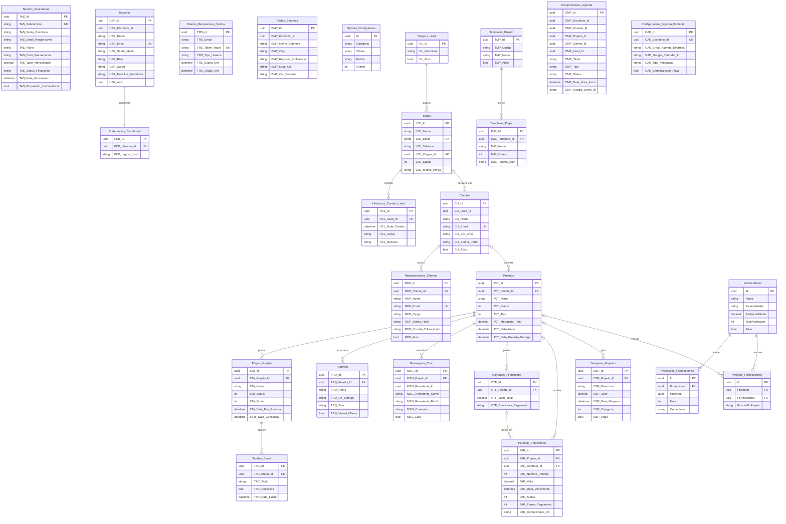

# Modelo de Dados Atualizado e Justificativa das Novas Tabelas

Este documento detalha a evolução completa da modelagem de dados da plataforma **COTU (ArchiFlow)** — comparando as **9 tabelas previstas no RFC v1.0** com as **25 tabelas de domínio por tenant** (`ArchiFlowDbContext`) e as **2 tabelas de governança SaaS** no banco master (`AdminDbContext`).

---

## 1. Visão Geral da Evolução (9 Tabelas → 25 + 2 Tabelas)

| Banco | Contexto EF Core | Quantidade de Tabelas | Finalidade |
| :--- | :--- | :---: | :--- |
| **Banco de cada Tenant** (`cotu`, `cotu_duna`, `cotu_tcc`, `cotu_staging`) | `ArchiFlowDbContext` | **25 tabelas** | Isolamento total dos dados operacionais de cada escritório de arquitetura. |
| **Banco Master SaaS** (`cotu`) | `AdminDbContext` | **2 tabelas** *(1 específica de governança SaaS + `Usuarios` SuperAdmin)* | Gestão centralizada de assinaturas, mensalidades, bloqueios e operadores da COTU (`app.cotu.com.br`). |

### Padrões Adotados na Modelagem Final
1. **Chaves Primárias UUID (`Guid`):** No RFC original, as PKs eram `int` autoincrementais. Migramos 100% das tabelas para `uuid` (`Guid`) para evitar ataques de enumeração/IDOR (ex.: adivinhar `/projetos/42`), facilitar geração de IDs no domínio e compatibilizar com arquitetura distribuída/multi-tenant.
2. **Prefixos de Coluna Padronizados (3 letras):** Tabelas principais adotam prefixos explícitos no PostgreSQL (ex.: `PJT_` para `Projetos`, `CLI_` para `Clientes`, `PAR_` para `Parcelas_Financeiras`) aumentando a legibilidade em queries e logs SQL.
3. **Normalização Temporal em UTC:** O `ArchiFlowDbContext` aplica `UtcDateTimeConverter` e `NullableUtcDateTimeConverter` globalmente em todas as propriedades `DateTime` / `DateTime?`, resolvendo divergências de fuso horário entre servidores Linux (UTC), navegador e Google Calendar.
4. **Integridade com Desacoplamento Opcional:** Lançamentos financeiros (`Contratos_Financeiros`, `Parcelas_Financeiras`, `Despesas_Projetos`) e vínculos de fornecedores (`Projetos_Fornecedores`) usam `OnDelete(DeleteBehavior.SetNull)` e `ProjetoId` anulável, permitindo despesas administrativas do escritório e preservando histórico financeiro mesmo se um projeto for excluído.

---

## 2. Diagrama Entidade-Relacionamento Atual (ERD Completo)

---

## 3. Catálogo Completo: Todas as Tabelas e Por Que Foram Criadas

### 3.1 Governança SaaS (Banco Master `cotu` — `AdminDbContext`)

| Tabela | Status vs. RFC | Prefixo | Por que foi criada / alterada |
| :--- | :---: | :---: | :--- |
| **`Tenants_Assinaturas`** | **Nova** | `TAS_*` | Criada para controlar o modelo comercial SaaS na `ArchiFlow.Admin.API`. Armazena o subdomínio único de cada escritório (`TAS_Subdominio`), plano (`Starter`, `Professional`, `Enterprise`), ciclo, valor mensal, vencimento, último pagamento, status financeiro (`Trial`, `Adimplente`, `EmDebito`) e bloqueio por inadimplência. |
| **`Usuarios`** *(Admin)* | **Nova** | `USR_*` | Separa os operadores internos/SuperAdmin da COTU (`app.cotu.com.br`) dos usuários dos escritórios clientes, evitando vazamento ou mistura de papéis administrativos globais com os tenants. |

---

### 3.2 Autenticação, Equipe, White-Label e Configurações (`ArchiFlowDbContext`)

| Tabela | Status vs. RFC | Prefixo | Por que foi criada / alterada |
| :--- | :---: | :---: | :--- |
| **`Usuarios`** | **Nova** | `USR_*` | O RFC assumia um "Arquiteto" implícito sem tabela de usuários da equipe. Foi criada para suportar múltiplos profissionais no mesmo escritório com papéis (`Administrador`, `Gerente`, `Colaborador`, `Estagiario`, `Financeiro`), cargo, foto no S3 e controle granular de acesso (`USR_Modulos_Permitidos`). |
| **`Tokens_Recuperacao_Senha`** | **Nova** | `TRS_*` | Criada para permitir fluxo seguro de *"Esqueci minha senha"* (tanto para equipe `staff` quanto para clientes), armazenando apenas o hash SHA-256 do token (`TRS_Token_Hash`), expiração, uso único (`TRS_Usado_Em`) e contador de tentativas. |
| **`Dados_Empresa`** | **Nova** | `EMP_*` | Criada para habilitar **White-Label** por escritório: armazena razão social, CNPJ, registro CAU (`EMP_Registro_Profissional`), slogan, endereço, logotipo no S3 (`EMP_Logo_Url`) e cor primária (`EMP_Cor_Primaria`), refletindo a marca do estúdio no sistema e no Portal do Cliente. |
| **`Opcoes_Configuracao`** | **Nova** | `—` | Criada como catálogo parametrizável por chave/categoria (`Categoria` + `Chave` únicas) com ícone, cor, ordenação e JSON extra, evitando listas hardcoded no frontend/backend. |

---

### 3.3 CRM Comercial (Leads e Clientes)

| Tabela | Status vs. RFC | Prefixo | Por que foi criada / alterada |
| :--- | :---: | :---: | :--- |
| **`Origens_Lead`** | **Nova (Normalizada)** | `OL_*` | No RFC, `origem` era um `varchar` livre na tabela `Lead`, sujeito a erros de digitação ("Insta", "instagram", "IG"). Foi normalizada para uma tabela própria administrável em `/configuracoes/origens-lead`, garantindo métricas confiáveis no funil. |
| **`Leads`** | **RFC Evoluída** | `LED_*` | Substituiu `origem` por FK `LED_Origem_Id` (`OnDelete(Restrict)`), adicionou `LED_Motivo_Perda` (para análise de perdas no Kanban, conforme fluxo alternativo 9.2 do RFC) e `LED_Atualizado_Em`. |
| **`Historicos_Contato_Lead`** | **RFC** | `HCL_*` | Mantida conforme RFC para registrar timeline de contatos (data, canal e resumo) com exclusão em cascata ao excluir o lead. |
| **`Clientes`** | **RFC Evoluída** | `CLI_*` | Mantida como entidade central do contratante; ganhou `CLI_Foto_Url` e mantém `CLI_Senha_Portal` para retrocompatibilidade com acessos legados. |
| **`Representantes_Clientes`** | **Nova** | `REP_*` | **Evolução importante:** clientes de arquitetura frequentemente são casais, empresas ou construtoras com mais de um responsável acompanhando a obra. Criou-se esta tabela vinculada a `Clientes` permitindo convidar múltiplos representantes com e-mail individual, token de convite assinado (`REP_Convite_Token_Hash`), ativação própria de senha e ativação/revogação independente. |

---

### 3.4 Gestão de Projetos, Etapas, Tarefas e Templates

| Tabela | Status vs. RFC | Prefixo | Por que foi criada / alterada |
| :--- | :---: | :---: | :--- |
| **`Projetos`** | **RFC Evoluída** | `PJT_*` | Evoluiu para usar enums tipados (`StatusProjeto`, `TipoProjeto`), `PJT_Metragem_Total`, `PJT_Atualizado_Em` e FK opcional (`SetNull`) para `ClienteId`. |
| **`Etapas_Projeto`** | **Nova (Normalizada)** | `ETo_*` | No RFC, a etapa atual era apenas uma string (`etapa_atual`) na tabela `Projeto`, e as tarefas referenciavam `projeto_id`. Na implementação real, um projeto possui N etapas ordenadas com ciclo de vida próprio (`ETo_Status`, `ETo_Ordem`, `ETo_Data_Fim_Prevista` adicionada após validação com a Duna Arquitetura e `dETo_Data_Conclusao`). |
| **`Tarefas_Etapa`** | **RFC Evoluída** | `TAR_*` | Passou a pertencer a uma `EtapaProjeto` (`TAR_Etapa_Id`), ganhou flag booleana `TAR_Concluida` e **`TAR_Data_Limite`** (para renderização integrada de prazos na Agenda e no Portal do Cliente). |
| **`Arquivos`** | **RFC** | `ARQ_*` | Mantida conforme RFC com controle explícito de visibilidade (`ARQ_Visivel_Cliente`) e URL do storage (Amazon S3 ou armazenamento local em dev). |
| **`Templates_Projeto`** | **Nova** | `TMP_*` | Criada para eliminar o retrabalho de cadastrar do zero as mesmas 4–5 fases em todo projeto novo. Armazena modelos reutilizáveis (ex.: *Residencial*, *Interiores*, *Comercial*, *Consultoria*). |
| **`Templates_Etapa`** | **Nova** | `TME_*` | Armazena as etapas ordenadas de cada template e o checklist padrão de tarefas serializado em `TME_Tarefas_Json`, instanciado automaticamente ao criar um projeto a partir de um template. |

---

### 3.5 Comunicação em Tempo Real e Experiência do Usuário

| Tabela | Status vs. RFC | Prefixo | Por que foi criada / alterada |
| :--- | :---: | :---: | :--- |
| **`Mensagens_Chat`** | **Nova** | `MSG_*` | O chat interno estava fora do escopo do RFC, mas mostrou-se indispensável para tirar as conversas técnicas do WhatsApp e centralizá-las no projeto/portal. Armazena mensagens enviadas via SignalR (`MSG_Remetente_Id`, `MSG_Remetente_Perfil`, `MSG_Conteudo`, `MSG_Lida`). |
| **`Preferencias_Dashboard`** | **Nova** | `PDB_*` | Criada após o feedback da Duna Arquitetura pedindo uma tela inicial mais limpa e focada na rotina de cada usuário (`O que fazer hoje`, `Financeiro da semana`, `Projetos por fase`, `CRM Leads`). Salva o layout em JSON indexado unicamente por `PDB_Usuario_Id`. |

---

### 3.6 Agenda Corporativa e Integração Google Calendar

| Tabela | Status vs. RFC | Prefixo | Por que foi criada / alterada |
| :--- | :---: | :---: | :--- |
| **`Compromissos_Agenda`** | **Nova** | `CMP_*` | Criada para centralizar visitas a obras, medições, reuniões com leads/clientes e entregas de etapas, com suporte a vínculos opcionais (`CMP_Projeto_Id`, `CMP_Cliente_Id`, `CMP_Lead_Id`), link do Google Meet (`CMP_Link_Google_Meet`) e sincronização bidirecional (`CMP_Google_Event_Id`). |
| **`Configuracoes_Agenda_Escritorio`** | **Nova** | `CAE_*` | Armazena as credenciais de integração por escritório com o Google Calendar, suportando tanto **Service Account** (`CAE_Chave_Service_Account_Json`) quanto **OAuth 2.0** (`CAE_Google_OAuth_Refresh_Token`, `CAE_Google_Client_Id`, `CAE_Google_Client_Secret`) e o ID da agenda oficial. |

---

### 3.7 Gestão Financeira (Antecipada do Pós-TCC)

| Tabela | Status vs. RFC | Prefixo | Por que foi criada / alterada |
| :--- | :---: | :---: | :--- |
| **`Contratos_Financeiros`** | **Nova** | `CTF_*` | No RFC havia apenas a tabela plana `Honorario`. Foi criado o cabeçalho de contrato (`CTF_Valor_Total`, `CTF_Condicoes_Pagamento`) para agrupar parcelas geradas em lote e suportar contratos com ou sem projeto vinculado (`CTF_Projeto_Id` anulável). |
| **`Parcelas_Financeiras`** | **RFC (`Honorario`) Evoluída** | `PAR_*` | Evolução direta da antiga entidade `Honorario`: controla número/total de parcelas, vencimento, pagamento, `PAR_Status` (`Pendente`, `Pago`, `Atrasado`, `Cancelado`), `PAR_Forma_Pagamento` (PIX, Transferência, Boleto, Cartão, etc.) e comprovante em storage (`PAR_Comprovante_Url`). |
| **`Despesas_Projetos`** | **Nova** | `DSP_*` | Atende ao RF29 (saídas financeiras) e à validação da Duna Arquitetura: controla despesas categorizadas (`PlotagemImpressao`, `DeslocamentoVisita`, `SoftwareLicencas`, `Subcontratacao`, `TaxasPrefeitura`, `Maquetes3D`, `Outros`), status de pagamento (`DSP_Pago`, `DSP_Data_Pagamento`), comprovante e suporte a **despesas administrativas avulsas sem projeto (`DSP_Projeto_Id` nullable)**. |

---

### 3.8 Gestão de Fornecedores (Antecipada do Pós-TCC)

| Tabela | Status vs. RFC | Prefixo | Por que foi criada / alterada |
| :--- | :---: | :---: | :--- |
| **`Fornecedores`** | **RFC Evoluída** | `—` | Antecipada do Pós-TCC; ganhou localização (`Cidade`, `Estado`), descrição, contador `TotalAvaliacoes` e média calculada (`AvaliacaoMedia`). |
| **`Avaliacoes_Fornecedores`** | **Nova (Normalizada)** | `—` | No RFC, avaliação e comentário ficavam dentro da tabela N:N `Proj_Fornecedor`. Separar `Avaliacoes_Fornecedores` permitiu múltiplas avaliações com autor e data (mesmo avulsas sem projeto) alimentando `RecalcularMedia()`. |
| **`Projetos_Fornecedores`** | **RFC (`Proj_Fornecedor`) Evoluída** | `—` | Mantém o vínculo N:N com papel específico no projeto (`FuncaoNoProjeto`) e usa `OnDelete(DeleteBehavior.SetNull)` em `ProjetoId` para preservar histórico mesmo se um projeto for removido. |
